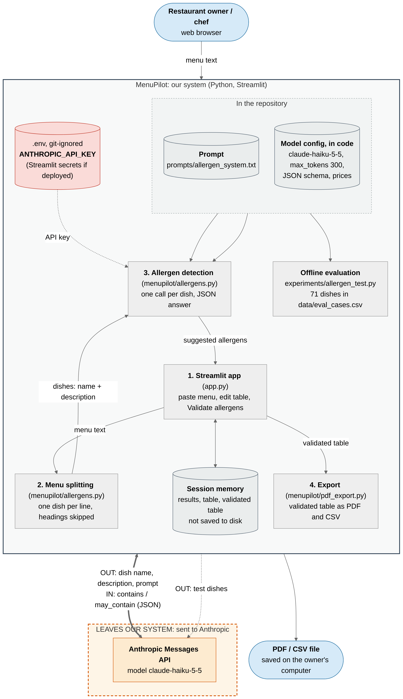

# Project log: MenuPilot

Team FAY · BPINFOR-131 Digital Transformation · WS 2026-27 · University of Luxembourg

Lead: Fabio Da Costa Neves · Members: Alihan Hakan, Yasmine Zeraidi

---

## M1: Problem and customer validation (12 October 2026)

### 1. Problem statement

Independent restaurants in Luxembourg must give guests written information on the 14 major allergens in every dish (EU Regulation 1169/2011 and national rules) [2], and inspectors check it every year (interview B). Restaurants with international guests also need several languages (five in interview B). Today this is done by hand: the owner writes the menu, multilingual staff or online tools translate it, and allergens are checked dish by dish. Each update repeats the work; a missed allergen is a safety and legal risk. The cost depends on how often the menu changes: about 2 hours a month in a restaurant updating 3–4 times a year, which its staff value at EUR 35–40 a month (interview B); little pain in a restaurant with a yearly menu and regular local guests (interview A).

### 2. Users, customers and segment

| | |
|---|---|
| **Users** | Owners, chefs and managers of independent restaurants, who write and update the menu. |
| **Customer (payer)** | In a small restaurant the same person; in a hotel or group, the budget holder. |
| **Beneficiaries** | Guests with allergies and international guests. |
| **Segment and size** | 1,270 restaurants in Luxembourg in 2025, excluding 389 fast-food outlets, cafés and bars (Retail Report 2026, national on-site survey updated July–October 2025) [1]. Assuming about 80% are independent, our segment is about 1,000 restaurants; we target 5% (≈50) within three years. |
| **First target** | Independent restaurants with frequent menu changes and international guests, then small hotel restaurants. Poor fit: yearly menu, local regulars (interview A). No chains. |
| **Scope** | MVP: upload a menu (PDF, photo or text), get FR/DE/EN translations and a draft allergen table, with questions to the chef on unclear dishes and owner approval. |

### 3. Interviews

Two interviews with staff (not owners) of independent restaurants, both covering spend (notes below). Hypothesis (repeated work at each change, fear of a wrong allergen): **partly confirmed**. Allergen rules are strict and inspected yearly, human review is a must, and one interviewee would pay EUR 35–40/month. But menus change less often than we assumed (1–4 times a year), translations are often done in-house, and current spend is close to zero.

Guide: 11 questions on context, current process, spend, allergens, alternatives, trust in AI and willingness to pay. Notes taken with consent; names of people and restaurants withheld.

#### Interview A

- **Role:** waitress, independent Italian restaurant, 50–55 covers per service.
- **Date and length:** 9 October 2026, 15 minutes.
- **Spend today:** none: the menu is printed by the drinks supplier under an agreement; no software.

Notes:
- There is a daily special, but the main menu changes only once a year.
- The owner writes the new menu by hand with the cooks; preparing it takes about a month.
- The menu is in French and Italian; allergens are indicated. No translation work: guests translate for themselves if needed.
- As far as she knows, the owner has never used menu software.
- Not interested personally: the restaurant knows its regular guests, who never ask about translations or allergens. The owner may see it differently.

#### Interview B

- **Role:** waiter-barman for three years, independent restaurant-bar hosting concerts and events, about 50 covers per service.
- **Date and length:** 9 October 2026, 20 minutes.
- **Spend today:** no software or translator; only server hosting for the digital menu. Staff time for menu work: about 2 hours a month.

Notes:
- Fixed menu, changed 3–4 times a year based on sales; no daily special or seasonal menu.
- The menu is fully digital (tablets and website), custom-coded by the manager, who has an IT background; the manager and the owner decide the changes.
- Allergens are shown as pictograms with a legend; inspectors check every year and are "very strict in Luxembourg"; the information is never out of date. No incident in three years.
- Menu in five languages (FR, EN, PT, DE, LU), translated by multilingual staff: about a minute per dish once the French text is written.
- No menu software, only an order-taking system.
- Trust: human review is always required, since a fatal allergy is possible and "*on ne va pas pouvoir mettre la faute sur ChatGPT*" ("we won't be able to put the blame on ChatGPT").
- Willingness to pay: for about 2 hours of work a month, around the hourly rate, EUR 35–40/month.

#### What the interviews suggest

- **Regulation is real:** allergens are inspected yearly; compliance matters to staff.
- **Trust:** AI output is acceptable only as a draft with mandatory human review.
- **Price:** EUR 35–40/month is a first anchor, in line with Menutech (EUR 15–60/month) [3].
- **Target:** the pain grows with menu changes and languages; restaurants with a yearly menu, local guests or multilingual staff need us less.

### 4. Existing alternatives

1. **Manual / in-house workaround.** The owner writes the menu; multilingual staff, Google Translate or DeepL translate it; allergens are checked dish by dish. Works where staff speak the languages (interview B), but depends on specific people and is redone at every change.
2. **Menutech (menu-writing software).** Auto-fills allergens and translations from its own dish database, from EUR 15/month (Subscription S up to EUR 60/month), 10-day free trial [3]. Each dish must still be typed in; house recipes outside its database need manual entry.
3. **Consumer menu-translator apps (Transleats, MenuGuide, Savoro).** Serve the diner's phone, not the restaurant's written allergen document; allergen output is "likely" or "potential", with a disclaimer to ask the restaurant [4].

Doing nothing is not an option: allergen information must be given in writing (LU, FR or DE) [2].

### 5. Value proposition

> For independent restaurant owners in Luxembourg who change their menu often for international guests and must redo translations and the allergen list each time, **MenuPilot** is an AI menu assistant that turns their existing menu file into a reviewed FR/DE/EN menu and allergen table in under 30 minutes, unlike retyping every dish into Word, a translator or database-driven tools such as Menutech.

### 6. Why AI

Menus are free text: "Judd mat Gaardebounen" lists no ingredients, and recipes vary between kitchens. Lookup tables only know dishes in their database. A language model can read any menu and recipe notes, translate with culinary context, draft the allergen table and ask the chef where it is unsure ("Does the sauce contain flour?"). Without AI, every dish is typed in by hand at each change.

### Sources (accessed 11 October 2026)

1. GIE Observatoire national des PME, *Retail Report 2026*, 4th edition, February 2026: <https://retailreport.eco.etat.lu/2026/RETAIL_REPORT_2026.pdf>
2. Division de la sécurité alimentaire, fiche F-178 "Allergènes": <https://securite-alimentaire.public.lu/dam-assets/fr/publications/guides/F-178-Fiche-question-reponse-allergenes.pdf>
3. Menutech, product and pricing page (plans, trial and languages as listed): <https://menutech.com/en>
4. App store listings: <https://mwm.ai/apps/transleats-ai-menu-translator/6760163296>; <https://apps.apple.com/qa/app/id6698861679>; <https://appgoblin.info/apps/6762811953>

---

## M2: Technology exploration and project proposal (due 19 October 2026)

### 1. Two candidate approaches compared

| | A: hosted API (`claude-haiku-5-5`) | B: local open model (`llama3.1:8b` via Ollama) | Baseline: keyword matching |
|---|---|---|---|
| Output quality: recall (all 59 scored cases) | 80% (94% counting `may_contain`) | 53% (69% counting `may_contain`) | 64% |
| Recall on real restaurant declarations (`menu_declared`, 18 cases) | 61% (86% counting `may_contain`) | 37% (61%) | 44% |
| Precision / exact match | 93% / 47% | 69% / 15% | 93% / 41% |
| Cost per unit | $0.000162 per dish (measured, 1,216 tokens in, 80 out), $0.0115 for the 71-case run | no API cost; runs on our own hardware | none |
| Latency (median / worst, per dish) | 0.97 s / 1.57 s | 0.73 s / 1.17 s on our laptop | negligible |
| Data needed | dish name and text, the shared prompt | the same | keyword list |
| Failure modes | misses allergens that are not named (recall 61% on real declarations), over-declares through `may_contain` | many wrong and missing allergens, weak on structured output and rare dishes | misses everything not named literally, cannot read hidden ingredients (edamame, wine, compound sauces) |
| Switching cost (lock-in) | medium: same prompt and JSON schema work elsewhere, the API call is provider-specific | low: open model, runs anywhere | none |

All three use the same dataset and scoring. Both AI backends use the same prompt (`prompts/allergen_system.txt`) and output format. The local model's latency depends on our hardware and says little about a production server. On the synthetic recipes with full ingredient lists the keyword baseline (92%) scores about the same as Claude (90%); Claude's advantage appears on real menu text (`menu_team_labelled`: 93% vs 57%; `menu_declared`: 61% vs 44%).

### 2. Experiment

Script: `experiments/allergen_test.py`; instructions: `experiments/README.md`; data: `data/eval_cases.csv`, 71 dishes in three groups (20 synthetic recipes, 21 team-labelled real menu entries, 30 entries with the restaurants' own declarations, 12 of them with a suspected declaration error that are scored separately). Metrics: recall (main), recall incl. `may_contain`, precision, exact match, median and worst latency, cost per dish, reported per group. Result files are committed in `experiments/results/`:

- Claude: `20261018-0024_claude_claude-haiku-5-5_*`
- Keyword baseline: `20261018-0025_keywords_keywords_*`
- Ollama: `20261018-0028_ollama_llama3.1-8b_*`

Audit cases (declaration suspected wrong, unconfirmed with the restaurants): in all 12, Claude's output differs from the declaration in the direction of the suspected problem, for example it reports molluscs for the scallop and squid dishes declared as crustaceans (DEC-21, DEC-22) and soy for the edamame declared with no allergen (DEC-24). This shows agreement with our suspicion, not proof of a restaurant error.

### 3. Chosen approach, limitations, switch triggers

Proposed choice (team to confirm): hosted `claude-haiku-5-5` with mandatory human review of every allergen table. It is the best of the three on every group of real menu text, costs under a cent per menu, and its answer is quick enough for an interactive upload.

Limitations:
1. Recall is not safe on its own: on real restaurant declarations it is 61% (86% when `may_contain` is counted), so the output is a draft that the owner must approve, never a legal declaration.
2. It over-declares: precision is 87% on the team-labelled menu entries and exact match is 47%, so owners will have to remove false alerts.
3. Evidence is small and imperfect: 59 scored cases, partly chosen for interesting cases; the labels of the team-labelled rows are drafted with AI help and checked by hand by the team; Kyo's allergen numbering is assumed. Scores are indicative.

Proposed switch triggers (team to confirm the thresholds):
- Switch to a local or other model if customers require that menu data stays inside the EU or on their own machine, and a model reaches at least the recall measured here on `menu_declared`.
- Switch provider or model if the cost per 40-dish menu rises above about EUR 0.10 (roughly 15 times today) or Anthropic stops offering the model.
- Re-evaluate the prompt if recall counting `may_contain` falls below 80% on `menu_declared` in a later run.

### 4. First architecture sketch

The planned MVP. The picture is kept as `docs/m2/m2_architecture_plan.png`; `docs/architecture.md` and README section 4 now describe the built MVP (M3).

- **User-facing:** one web app for the owner or chef: upload page, review page (chef questions, edits, approval), export.
- **Our services:** text extraction (PDF text layer and plain text, read locally) and a Python AI pipeline that splits the menu into dishes, translates it and drafts the allergens. Data store for the MVP: session files on our machine, no database.
- **External API and model:** Anthropic Messages API, `claude-haiku-5-5`. Prompts live in `prompts/`; the model name, `max_tokens` and prices are in the code.
- **Leaves our system:** dish names and menu text, and a menu photo only when the file has no text layer. No interview or guest data.
- **Secrets:** `ANTHROPIC_API_KEY` in `.env`, which is git-ignored; `.env.example` is committed instead.
- **Switch option:** the API call can be replaced by `llama3.1:8b` through Ollama; then nothing leaves our system.

### 5. First cost estimate

Price list: Claude Haiku 5.5, $0.10 per 1M input tokens and $0.50 per 1M output tokens for prompts up to 100,000 tokens (batch: $0.05 / $0.25; cache hit: $0.01), Anthropic pricing page, <https://platform.claude.com/docs/en/about-claude/pricing>, checked 18 October 2026 (the page shows no date of its own).

One user action = one dish, from the 71-case run (mean 1,216 input and 80 output tokens): 1,216 × $0.10 / 1,000,000 = $0.0001216; 80 × $0.50 / 1,000,000 = $0.00004; total $0.000162, matching the $0.000162 mean cost reported by the script (whole run: $0.0115). One 40-dish menu: 40 × $0.000162 = $0.0065. At 12 menu updates a year: about $0.08 per restaurant per year in AI cost. Most input tokens are the fixed system prompt repeated per request, so prompt caching or batching would lower this further.

### 6. Plan to the MVP (M3, due 16 November 2026)

MVP scope: the owner uploads one menu (PDF or text, photo if time allows) and gets a draft allergen table with the `may_contain` allergens turned into chef questions, FR/DE/EN translations, and an approval step. M3 asks for one AI feature working end to end on real input, so the allergen draft is the must-have; translation and export come next. If we are behind on 8 November, the "Should" tasks move to M4 and we ship the allergen flow alone.

Owners are a first proposal, to be adjusted by the team. Each task is done on its own branch and merged through a pull request with "Create a merge commit", so every member's work shows in the history. Weekly 30-minute check-in after the Wednesday class.

| # | Task | Owner | Due | Priority |
|---|---|---|---|---|
| 1 | Choose the web framework (proposal: Streamlit, Python, quick to build) and set up the app skeleton in `app/`, runnable locally | Fabio | Sun 25 Oct | Must |
| 2 | Collect 5 example menus (PDF, photo, text) that we may use into `examples/`, with source and permission | Yasmine | Sun 25 Oct | Must |
| 3 | Upload page and text extraction: PDF text layer and plain text; photos through the API | Alihan | Sun 1 Nov | Must |
| 4 | Split the menu text into dishes (name + description), tested on the 5 example menus | Fabio | Sun 1 Nov | Must |
| 5 | Move the allergen call from the experiment script into a shared module used by the app and by `experiments/allergen_test.py` | Yasmine | Sun 1 Nov | Must |
| 6 | Review page: allergen table per dish, `may_contain` shown as chef questions, edit and approve | Fabio | Sun 8 Nov | Must |
| 7 | Translation FR/DE/EN: prompt in `prompts/translate_system.txt`, checked by hand on 10 dishes | Alihan | Sun 8 Nov | Should |
| 8 | Export the approved menu and allergen table (CSV first, then PDF) | Yasmine | Sun 8 Nov | Should |
| 9 | End-to-end test on 3 real menus; list at least 3 known bugs or limitations | All | Wed 11 Nov | Must |
| 10 | Fresh-machine test: start the app from the README in 5 steps or fewer on a laptop that is not the developer's; fix the README | Alihan | Fri 13 Nov | Must |
| 11 | Update the architecture diagram to what was actually built | Alihan | Fri 13 Nov | Must |
| 12 | 3-minute demo video, M3 one-page summary, who did what since M2, tag `m3` | Fabio, Yasmine | Sun 15 Nov | Must |

### 7. Repository

Repository created, README skeleton in place, licence added (MIT for code; menu texts excluded). The repository is private, because it contains restaurant menu texts and Wolt listings (see Decisions); both teachers are added as collaborators.

### Decisions

- **Private repository and Wolt terms.** Wolt's user terms for Luxembourg (version of 7 August 2026), section 13.6(vi), restrict collecting, copying or transferring information from the service without Wolt's consent; 16 dataset rows (MEN-01 to MEN-16) come from Wolt listings. Only dish names and short descriptions are kept, with their source, and are removed on request. For this reason the repository is private. Source: <https://explore.wolt.com/en/lux/terms>.
- **Labels.** The ground-truth labels of the 41 team-labelled rows were drafted with Claude. A review pass on 18 October 2026 annotated five judgment-call rows (MEN-15, MEN-08, REC-07, REC-19, MEN-11).
- **Kyo.** The menu PDF has no legend; the standard 1 to 14 numbering is assumed (it matches the obvious cases) and is unconfirmed.
- **Who did what (M2).** Yasmine: set up the M2 tasks, the test and evaluation scripts, and the evaluation and restaurant data. Fabio: experiment runs, cost arithmetic, documentation. Alihan: architecture sketch, MVP plan, completion of this M2 section and the one-page summary.
- **AI use in M2.** The dataset drafts, labels, experiment script and cost arithmetic were produced with Claude and reviewed by the team. The architecture diagram, MVP plan and one-page summary were drafted with Claude and reviewed by Alihan.

## M3: Minimum viable product (due 16 November 2026)

### Summary

- **What runs:** a Streamlit app (`streamlit run app.py`): the owner pastes a menu, the app splits it into dishes (skipping section headings), asks `claude-haiku-5-5` once per dish, and shows an editable allergen table. The owner corrects it, validates it, and downloads a CSV or a menu-style PDF with "Allergens: 1, 7" per dish.
- **AI feature, real input, no mocks:** allergen detection on real Luxembourg menus (Le Quai Steffen, Luci) and on our own test menu. Result on the two real menus (64 dishes, unedited output): strict recall 47% (81% with "To confirm"), precision 84%. Strict recall is lower than in M2 (61%); counting "To confirm" it is close (81% vs 86%). Cost about $0.00016 per dish (M2 run: $0.0115 for 71 dishes), median 0.9 s per dish.
- **Architecture:** `docs/architecture.png` and `docs/architecture.md` (as built; M2 sketch kept as `docs/m2/m2_architecture_plan.png`).
- **Known bugs:** `KNOWNBUGS.md` (at least 3, with the fixed ones ticked).
- **Who did what since M2:**
  - Yasmine: allergen module, Streamlit app, run steps in the README, demo video.
  - Alihan: heading detection and the editable, validated table. Fabio: three menu tests and comparison, `KNOWNBUGS.md`, fixes, PDF and CSV export, architecture diagram, documentation.
- **Demo video (3 min, unlisted):** https://youtu.be/XMH5x-pTOUc

### AI use in M3
Code drafted with Claude (claude.ai and Claude Code), then read, run and tested by the team. The allergen detection itself uses `claude-haiku-5-5` through the Anthropic API (forced tool call, same prompt as M2).

### Decisions
- The model drafts, the owner validates: no export before validation.
- No file is stored; menu text stays in session memory. Menu texts and restaurants' declared allergens are not committed (data rights).
- Dish-level prompt fixes and the evaluation re-run are left for M4 (see `KNOWNBUGS.md`).

### Not built (planned later)
Menu upload (PDF/photo), translation, deployment, owner-facing hosting: see `TODO.md`.

### 2026-11-04 — First end-to-end version (Yasmine)

**Done**
- Extracted the allergen detection from `experiments/allergen_test.py` into `menupilot/allergens.py`
  (same prompt, same JSON schema, same user message as in M2, so the M2 results still describe the app).
- Added a minimal Streamlit app (`app.py`): paste a menu, one dish per line, and get the
  suggested allergens of each dish, with cost and latency.
- Wrote the "How to run it" section of the README; cleaned up `.gitignore` (`.agents/`, `.claude/`).
- Code drafted with Claude (claude.ai), then read, run and tested by Yasmine.

**First real test** (claude-haiku-5-5, 3 dishes, total cost $0.0005, median latency 0.9 s per dish)
Screenshot: `docs/m3_first_test.png`

| Dish (input as pasted) | Expected (eval set) | Contains | May contain | Reading |
|---|---|---|---|---|
| Bouneschlupp - haricots verts, pommes de terre, lardons, céleri-rave, crème fraîche | celery, milk | celery, milk | gluten | Correct. |
| Gromperekichelcher | gluten, eggs | eggs, gluten, milk | celery | False positive: milk. With the dish name only, the model falls back on a "typical" recipe, which may differ from the restaurant's. |
| Rieslingspaschtéit - pâte feuilletée, porc, veau, Riesling, jaune d'oeuf | gluten, milk, eggs, sulphites | eggs, gluten, sulphites | celery, milk, mustard | Milk only in "may contain": the butter in the puff pastry was not written in the input. Hidden sulphites from the wine were found. |

**What this tells us**
- Short menu texts lead to both missed and extra allergens. This confirms that the owner must
  validate every dish before publishing: the editable table is the next task.
- Candidate failure cases for the M4 evaluation.

**Known limitations so far**
- Section headings: common ones ("Entrées", "Desserts", "Plats"…) are now skipped and shown to the owner as skipped; unusual headings are still treated as dishes.
- No export yet.

### 2026-11-11 — Heading detection and validation step (Alihan)

**Done**
- Menu splitting skips common section headings ("Entrées", "Desserts", "Plats"…); the app lists the skipped lines so nothing disappears silently.
- The allergen table is now editable: one checkbox per allergen and dish, ticked when the model reports it in `contains`. The `may_contain` allergens are shown in a "To confirm" column, as questions for the chef.
- The owner corrects the table and clicks "Validate allergens"; changing it afterwards asks for a new validation.
- This is our answer to the recall limit measured in M2: the model drafts, the owner decides.

### 2026-11-13 — Test on real menus and known bugs (Fabio)

**Done**
- Test 1: claude-haiku-5-5 on a generated French test menu (12 dishes with headings, prices and short descriptions, written by us, not a real restaurant); the section headings were skipped as intended.
- Architecture diagram updated to what is built (`docs/architecture.png`, Mermaid source and explanation in `docs/architecture.md`, README section 4): Streamlit app, menu splitting, allergen detection with `claude-haiku-5-5`, prompt and model config locations, session memory, export, the boundary of what goes to Anthropic, and the API key in `.env`. The M2 sketch that planned upload and translation is kept as `docs/m2/m2_architecture_plan.png`.
- Fixes from KNOWNBUGS.md (before M3): headings with an article or a combined heading ("Les Entrées", "Poisson & Viande", "Fromages & Desserts") and more heading words ("Fish", "Burgers", "From the Grill") are skipped; a "Not a dish" checkbox per row for any other line, excluded from the validated table and from the downloads; rows with no allergen are marked "No allergen found: please check" and listed in a warning before validation. Checked on the three test menus and on the 71 dishes of `data/eval_cases.csv` (none wrongly skipped). The prompt-level bugs are still open (M4).
- Export: after "Validate allergens" the app offers "Download as CSV" (the validated table: one True/False column per allergen plus "To confirm"; we use it to compare the output with restaurants' declared allergens) and "Download as PDF". The PDF (`menupilot/pdf_export.py`, reportlab) is an A4 menu with each dish and its allergen numbers ("Allergens: 1, 7"), the key to the 14 numbers (EU order) at the bottom of every page, the validation date and a note that the allergens were suggested by an AI model and checked by the owner. It lists dish names only (no descriptions, prices or section headings). The download only appears while the table matches the validated one.
- Test 2: a real menu from Le Quai Steffen (Luxembourg, public website, dish names only); its declared allergens are used to compare with the app's output.
  - Result (40 dishes, unedited model output): recall 46% (68 of 149 declared allergens reported as certain), 84% counting "To confirm"; precision 88%; exact match 3 of 40; 2.7 questions per dish on average. Without sulphites: 56% (89%).
  - Most of the gap is sulphites: Le Quai Steffen declares them in 29 of 40 dishes (even a plain ribeye steak), which the model cannot know. Mustard (12 misses) and milk (10) follow.
  - Never asked about: sulphites (veal kidneys, ribeye, tarte tatin, cheese plate), eggs and milk ("Beef tagliata with truffle oil"), mustard ("Cheese plate", "Bone marrow, fries and salad").
  - Extras the restaurant does not declare: eggs (6 dishes), milk (2), sesame (1); some may be gaps in their declaration.
  - New bug: four unusual headings ("The Essentials of Luxembourg", "Fish", "From the Grill", "Burgers") were treated as dishes.
  - The restaurant's declaration is not always consistent, so the comparison is indicative. Menu text and allergen list are not committed.
- Test 3: a real menu from Luci (Luxembourg, public menu page in French), 24 dishes with declared allergens compared with the unedited model output.
  - Result: recall 52% (25 of 48), 71% counting "To confirm"; precision 74%; exact match 5 of 24.
  - The page gives allergen numbers without a legend; we assume the standard EU numbering 1 to 14 (unconfirmed). The restaurant codes seafood oddly (mussels and clams as fish or crustaceans, not molluscs): without those 9 misses recall is about 64% (about 82%).
  - New bugs: all four French headings ("Les Entrées", "Les Pâtes", "Poisson & Viande", "Fromages & Desserts") were treated as dishes with made-up allergens; "Le dessert du jour" got no allergens and no question (declared: gluten, milk); nuts declared for 4 dishes were never reported or asked about.
  - For the classic tiramisu the restaurant declares no eggs and the model reports them; probably the restaurant's omission.
- Both real menus together (64 dishes): recall 47% (93 of 197), 81% counting "To confirm", precision 84%, close to M2 (61% and 86%).
- New file `KNOWNBUGS.md` in the repository root: the working list of bugs found in the three tests and the planned fixes (small fixes before M3, prompt and evaluation changes for M4). Each fixed issue will be ticked there and logged here with its commit, so M4 can show at least 5 issues with the change that fixed them.

### 2026-11-16 — Clean-install test (Yasmine)
- Fresh clone of `mvp-app` + empty virtual environment
- Following README section 3 only: install, allergen detection, heading skipping, validation and CSV/PDF export all work.

**Known bugs and limitations (found in test 1, the generated menu)**
- Dishes without a description get confident answers instead of questions (e.g. "Tarte aux quetsches": gluten, eggs and milk reported as certain, nothing to confirm; "Gromperekichelcher": milk reported, but the usual recipe has none).
- Wine is not reliably reported as sulphites ("Linguine aux crevettes ... vin blanc", "Rieslingspaschtéit": sulphites only under "To confirm").
- Some dishes produce too many questions (8 for "Soupe de poisson"), which makes the chef review slow.
- Our readings use typical recipes and are not yet checked with a chef. Details in README section 7.
