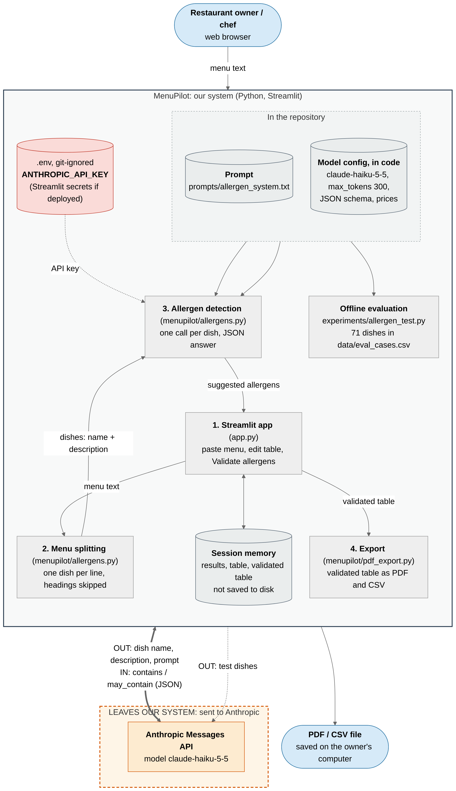

# MenuPilot - Public Version

AI menu assistant for independent restaurants in Luxembourg: one menu upload in, a reviewed multilingual menu and allergen table out.

> **Note:** This repository is a public copy of a team project (University of Luxembourg, 2026).
> Real restaurant menu data and per-dish results have been removed; `data/eval_cases.csv` contains only
> the 20 synthetic cases written by the team. Results reported below were measured on the full 71-case dataset.
>
> **My role (Yasmine Zeraidi):** allergen detection module (`menupilot/allergens.py`), Streamlit app (`app.py`),
> test and evaluation scripts, user interviews.
> 
> This project is still in progress.
---

## 1. What it does

<!-- ≤100 words. Update once the MVP works. -->

MenuPilot turns a restaurant's existing menu (PDF, photo or text) into French, German and English versions and a draft table of the 14 regulated allergens. When a dish is unclear, it asks the chef targeted questions ("Does the sauce contain flour?") instead of guessing. The owner reviews and approves the result before anything is published.

## 2. Users and value proposition

- **Users:** owners, chefs and managers of independent restaurants, who write and update the menu.
- **Customer (payer):** in a small restaurant the same person; in a hotel or group, the budget holder.
- **Beneficiaries:** guests with allergies and international guests.

> For independent restaurant owners in Luxembourg who change their menu often for international guests and must redo translations and the allergen list each time, **MenuPilot** is an AI menu assistant that turns their existing menu file into a reviewed FR/DE/EN menu and allergen table in under 30 minutes, unlike retyping every dish into Word, a translator or database-driven tools such as Menutech.

## 3. How to run it

<!-- ≤5 steps, tested on a machine that is not ours. -->

1. Clone the repository and open a terminal at its root.
2. Install the dependencies: `python -m pip install -r requirements.txt`
3. Copy `.env.example` to `.env` and put your Anthropic API key in it.
4. Start the app: `python -m streamlit run app.py`
5. Open http://localhost:8501, paste a menu (one dish per line) and click "Find allergens". Correct the ticked allergens if needed, then click "Validate allergens".

**Re-running the M2 allergen experiment** (evaluation script, separate from the app):
1. `pip install -r requirements.txt`
2. Copy `.env.example` to `.env` and add an Anthropic API key (created with a workspace). Only the `claude` backend needs it.
3. `python experiments/allergen_test.py --backend keywords` (baseline, no AI, no key)
4. `python experiments/allergen_test.py --backend claude --limit 5`, then without `--limit` for all 71 cases
5. Optional local model: install Ollama, `ollama pull llama3.1:8b`, then `--backend ollama` (no key). Details and metrics: [experiments/README.md](experiments/README.md).

## 4. Architecture

<!-- Diagram (draw.io, Excalidraw, Mermaid or PlantUML) exported as PNG/SVG into docs/, plus ≤150 words.
The diagram must show: user-facing parts, our services, data stores; every external API and model by
name and version; where prompts and model config live; direction of data flow; a marked boundary
showing which data leaves our system and to whom; how secrets are handled. -->

Current version (M3); details and the editable Mermaid source are in [docs/architecture.md](docs/architecture.md). The owner pastes a menu (one dish per line) into the Streamlit app (`app.py`). `menupilot/allergens.py` splits it into dishes and sends each dish, with the prompt from `prompts/allergen_system.txt`, to the Anthropic Messages API (`claude-haiku-5-5`, forced JSON answer with `contains` and `may_contain`). The app shows one checkbox per allergen; `may_contain` appears as "To confirm", the questions for the chef. The owner corrects the table and clicks "Validate allergens"; only then can it be downloaded as PDF or CSV (`menupilot/pdf_export.py`).

**Leaves our system:** dish names and descriptions, one request per dish, to Anthropic. Nothing is written to disk: results live in the session memory only.

**Secrets:** `ANTHROPIC_API_KEY` is in `.env` (git-ignored; `.env.example` shows the format), or in the hosting platform's secrets once deployed.

**Not built yet:** file upload (PDF, photo) and translation. The M2 sketch that planned them is kept in `docs/m2/m2_architecture_plan.png`.

## 5. AI components

<!-- Models and APIs (name + version), where the prompts live, data sources. -->

| Component | Model / API (version) | Purpose | Prompt / config location |
|---|---|---|---|
| TODO | TODO | Menu extraction (PDF / photo → text) | TODO |
| TODO | TODO | Translation FR/DE/EN | TODO |
| Allergen detection (MVP) | `claude-haiku-5-5` (Anthropic Messages API, forced tool call for JSON output) | Allergen draft with `contains` / `may_contain` per dish | Prompt: `prompts/allergen_system.txt`; model name, prices and JSON schema: `menupilot/allergens.py`; evaluation backends (incl. `llama3.1:8b` via Ollama): `experiments/allergen_test.py` |

**Data sources:** `data/eval_cases.csv`, 71 dishes: 20 synthetic recipes, 21 real menu entries labelled by the team, 30 real menu entries with the restaurants' own allergen declarations (Stella Rosa, Kyo). Menu texts come from restaurant websites, PDF menus and Wolt listings and belong to their restaurants. Allergen list: the 14 allergens of EU Regulation 1169/2011, Annex II. See [data/README.md](data/README.md).

## 6. Evaluation

<!-- Task and what counts as correct; ≥20 cases or ≥5 test users with a written script; at least one
metric (accuracy, task success, latency median/worst, cost per interaction); a baseline (manual or
simpler model); results table before/after; ≥3 failure cases quoted verbatim with our reading. -->

- **Task:** given a dish name and its menu text or ingredient list, report which of the 14 EU allergens it contains (`contains`) and which must be confirmed with the chef (`may_contain`).
- **Metric(s):** allergen recall (main metric, a missed allergen is the dangerous error), precision, exact match, median and worst latency, cost per dish from real token counts. Reported per dataset group, never as one global number. Still to add later: time to a validated menu vs. the 30-minute target.
- **Baseline:** keyword matching without AI (`--backend keywords`); the manual process is the second reference.

| Version | Metric (recall, 59 scored cases) | Result |
|---|---|---|
| Baseline: keyword matching, no AI | recall / precision | 64% / 93% |
| Local model `llama3.1:8b` (Ollama) | recall / precision | 53% / 69% |
| Before changes: `claude-haiku-5-5`, first prompt | recall / precision | 80% / 93% (94% recall counting `may_contain`) |

Per group, Claude: `recipe_synthetic` 90%, `menu_team_labelled` 93%, `menu_declared` 61% recall. Full tables: `experiments/results/`. 12 of the 71 cases have a suspected declaration error and are scored separately.

**Main weakness so far:** recall on real restaurant declarations (`menu_declared`) is 61%, 86% when `may_contain` is counted.

## 7. Limitations, risks, privacy and ethics

<!-- ≤250 words: personal data handled, where it goes, retention, interview consent, bias risks,
whether the EU AI Act applies. -->

- **Safety:** a wrong or missing allergen can harm a guest. The output is a draft only; the owner must approve it.
- **Personal data:** the evaluation dataset contains only dish names and short menu descriptions, no personal data. For the M1 review, our interview notes were pasted into Claude; they contained no names or contact details, as interviewees were anonymized (roles only). From M2 on, no interview data is sent to third-party AI services.
- **Interview consent:** notes taken with consent; names of people and restaurants withheld.
- **EU AI Act:** TODO
- **Data rights:** menu texts belong to their restaurants and are used for research and evaluation only. Wolt's user terms (section 13.6, version of 7 August 2026) restrict collecting or copying information from the service without consent; 16 rows (MEN-01 to MEN-16) come from Wolt listings. Only dish names and short descriptions are kept, with their source, and are removed on request.
- **Known limitations (M2):** ground-truth labels are drafted with AI assistance and checked by hand by the team (see `data/README.md` for the current status); Kyo's allergen numbering is assumed to follow the standard 1 to 14 list and is unconfirmed; the dataset is small and partly chosen for interesting cases, so scores are indicative, not error rates for whole menus.
- **Known limitations (MVP, M3):** one dish per line; common section headings ("Entrées", "Desserts", "Plats"…, in FR/EN/DE/IT) are skipped and listed in the app, but unusual headings still go through as dishes; after validation the table can be downloaded as a PDF menu (editable title, dish names with their allergen numbers, the key to the 14 numbers and the validation date in the footer; no descriptions, prices, section headings, restaurant name or logo) or as a CSV (one True/False column per allergen plus the "To confirm" column, used for our tests); with a dish name only, the model assumes a typical recipe (e.g. adds milk to Gromperekichelcher).
- **KNOWNBUGS.md:** the working list of bugs and planned fixes, ordered by when we fix them (before M3, after M3), with the evaluation steps needed to show before/after results. It is updated as bugs are fixed; this section keeps the short version.
- **Known bugs found in our menu tests (M3, 13 November 2026):** test 1 used a generated French menu (12 dishes), test 2 a real menu from Le Quai Steffen (Luxembourg, in English) and test 3 a real menu from Luci (Luxembourg, in French). Our readings are based on typical recipes and are not yet checked with a chef.
    1. Dishes without a description get confident answers instead of questions. Example: "Tarte aux quetsches" (no description) is reported as containing gluten, eggs and milk, with nothing to confirm. "Gromperekichelcher" is reported as containing milk, but the usual recipe (potato, flour, egg, onion) has none.
    2. Wine is not reliably reported as sulphites. Examples: "Linguine aux crevettes - ail, persil, vin blanc" and "Rieslingspaschtéit": sulphites appear only under "To confirm", although wine normally contains them.
    3. Some dishes produce too many questions. "Soupe de poisson" gets 8 allergens under "To confirm" (celery, crustaceans, eggs, gluten, milk, molluscs, mustard, sulphites), which is slow to review.
    4. Typical ingredients are sometimes flagged without support in the text (for example celery and mustard for "Rieslingspaschtéit").
    5. The output is a draft only: the owner must check and validate every dish before publishing (M2 recall on real restaurant declarations: 61%).
    6. Unusual section headings are still treated as dishes. Le Quai Steffen: "The Essentials of Luxembourg", "Fish", "From the Grill" and "Burgers" were analysed as dishes ("Burgers" got gluten and 6 questions), while "Soups", "Starters", "Mains" and "Desserts" were skipped. Luci: all four French headings ("Les Entrées", "Les Pâtes", "Poisson & Viande", "Fromages & Desserts") became table rows with made-up allergens (e.g. gluten and eggs for "Les Pâtes"); the heading list does not match a heading with an article ("Les Entrées") or a combined one ("Poisson & Viande"). Fixed on 13 November for these cases (articles, combined headings and more words are now recognised; a "Not a dish" checkbox covers any other line), see KNOWNBUGS.md.
    7. Allergens that come from stocks, sauces and wine are mostly not reported as certain. Le Quai Steffen declares sulphites in 29 of 40 dishes (even for a plain ribeye steak); the model reports them as certain in 1 dish and asks about them in most others. Mustard (12 misses) and milk (10) are the next largest gaps.
    8. A dish whose name says nothing can get an empty answer with no question. Luci: "Le dessert du jour" got no allergens and nothing to confirm, while the restaurant declares gluten and milk. An empty row looks like "safe", which is the dangerous case. Since 13 November the app marks such rows ("No allergen found: please check") and warns before validation; the model itself still answers nothing for such dishes, to be fixed in the prompt (KNOWNBUGS.md).
- **Test on a real menu (13 November 2026):** 40 dishes of Le Quai Steffen (Luxembourg, public menu page, dish names only) compared with the allergens the restaurant declares there, using the unedited model output (claude-haiku-5-5). Recall 46% (68 of 149 declared allergens reported as certain), 84% counting "To confirm"; precision 88%; exact match 3 of 40 dishes; 2.7 questions per dish on average. Without sulphites, recall is 56% (89% counting "To confirm"). Allergens never asked about: sulphites for "Veal kidneys in mustard sauce" and "Ribeye steak", eggs and milk for "Beef tagliata with truffle oil", mustard and sulphites for "Cheese plate", sulphites for "Tarte tatin", mustard for "Bone marrow, fries and salad". The model also reported eggs (6 dishes), milk (2) and sesame (1) that the restaurant does not declare; the restaurant's own declaration is not always consistent, so the comparison is indicative. The menu text and the restaurant's allergen list are not stored in this repository.
- **Test on a second real menu (13 November 2026):** 24 dishes of Luci (Luxembourg, public menu page in French; dishes without declared allergens left out) compared with the allergens the restaurant declares there, unedited model output. The page gives allergen numbers without a legend; we assume the standard EU numbering 1 to 14, which is unconfirmed, and the restaurant codes seafood in a way that does not fit it (mussels and clams as fish or crustaceans, never molluscs). Recall 52% (25 of 48 declared allergens reported as certain), 71% counting "To confirm"; precision 74%; exact match 5 of 24 dishes. Without the 9 fish and crustacean "misses" on shellfish dishes, which come from the restaurant's coding, recall is about 64% (about 82% counting "To confirm"). Nuts (declared for 4 dishes) were never reported or asked about; we cannot see where nuts would come from, so the declaration itself may be the problem. For the classic tiramisu the restaurant declares no eggs while the model reports them; the model is probably right.
- **Both real menus together (64 dishes):** recall 47% (93 of 197), 81% counting "To confirm", precision 84%. This is close to the M2 result on restaurant declarations (61% and 86%). The bugs and the fixes we plan are listed in [KNOWNBUGS.md](KNOWNBUGS.md).

## 8. Business case

<!-- 15% of the project grade. Rough numbers are fine; unstated assumptions and absent arithmetic are not. -->

1. **Customer and user:** the owner or chef uses it; in small restaurants the same person pays and decides; in hotels the manager proposes and the owner or group approves.
2. **Segment and size:** 1,270 restaurants in Luxembourg in 2025, excluding fast food, cafés and bars (Retail Report 2026, accessed 11 October 2026). Assuming ~80% independent → ~1,000; target 5% (≈50) within three years.
3. **Business model:** TODO (likely monthly subscription per restaurant).
4. **Price and evidence:** interviewee B would pay EUR 35–40/month (interview, 9 October 2026); Menutech charges EUR 15–60/month (menutech.com, accessed 11 October 2026).
5. **Unit economics:** unit = TODO (e.g. one active restaurant per month)
    - AI/API cost per unit: Claude Haiku 5.5, $0.10 per 1M input tokens and $0.50 per 1M output tokens (Anthropic pricing page, checked 18 October 2026). Measured on the 71-case run, averaging 1,216 input and 80 output tokens per dish: 1,216 × $0.10 / 1M + 80 × $0.50 / 1M = $0.000162 per dish (the whole run cost $0.0115). A 40-dish menu costs about $0.0065; at 12 menu updates a year, about $0.08 per restaurant per year.
    - Other variable costs: TODO (hosting, storage)
    - Total variable cost / price / contribution margin / margin %: TODO
6. **Fixed costs and break-even:** TODO
7. **Cold start:** TODO
8. **Competition:**
    - Manual / in-house workaround: free, but depends on specific staff and is redone at every change.
    - Menutech: database-driven; each dish must be typed in.
    - Consumer menu-translator apps (Transleats, MenuGuide, Savoro): serve the diner, not the restaurant's legal allergen document.
9. **Go-to-market:** TODO (channel for the first 100 users, cost per acquisition)
10. **Risks:** TODO (model prices/availability, data rights, GDPR, EU AI Act, single dependencies)
11. **Next steps (3 months, EUR 50,000):** TODO

## 9. AI tools the team used

| Tool | Used for |
|---|---|
| Claude (Anthropic) | M1 review, market research, LaTeX and Markdown drafting; M2: drafting of the evaluation dataset and labels, experiment script, cost arithmetic, repository documentation, architecture diagram (Mermaid source), MVP plan and M2 one-page summary ; M3: reviewing of `menupilot/allergens.py` and `app.py`, troubleshooting environment issues. | 

## 10. Who did what

| Member | Contributions |
|---|---|
| Fabio Da Costa Neves | M1 Report, M2 experiment runs, evaluation and documentation; M3: tests on a generated menu and two real menus (Le Quai Steffen, Luci) compared with the restaurants' declared allergens, `KNOWNBUGS.md`, heading fixes, "Not a dish" checkbox and warning for empty rows, CSV and PDF download, architecture diagram (`docs/architecture.md`), clean-install test, M3 PROJECT_LOG and one-page summary |
| Alihan Hakan | M2: architecture sketch (`docs/architecture.md`), plan to the MVP, completion of the M2 log and one-page summary; M3: heading detection (branch `fix-menu-headings`), editable allergen table with the "Validate allergens" step (branch `validation-table`), README and PROJECT_LOG updates for both |
| Yasmine Zeraidi | Interviews, M1 Report; M2: task planning, test and evaluation scripts, evaluation and restaurant data ; M3: allergen module (`menupilot/allergens.py`), Streamlit app (`app.py`), first end-to-end test, "How to run" section, 3-minute demo video |

---

## Licence

Code, prompts and documentation: MIT (see `LICENSE`). The restaurant menu texts in `data/eval_cases.csv` are not covered by it and remain the property of their restaurants.
