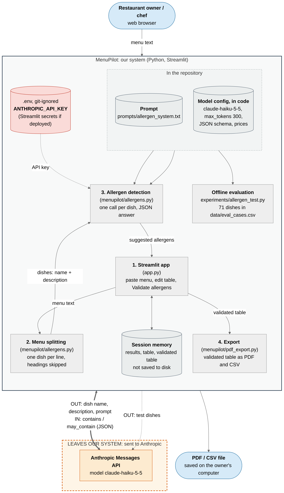
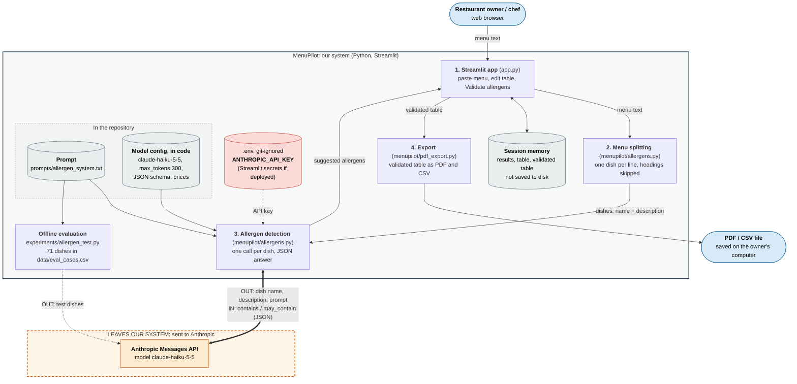

# Architecture (M3, 13 November 2026)

**Status:** this is what is built today (the M3 MVP). The M2 sketch, which also planned file upload and translation, is kept as [m2_architecture_plan.png](m2/m2_architecture_plan.png).

## How it works

The owner pastes a menu (one dish per line) into the Streamlit app (`app.py`). `menupilot/allergens.py` splits it into dishes (name and description; section headings such as "Entrées" are skipped, and any other line can be ticked "Not a dish"). For each dish, one request goes to the Anthropic Messages API with the prompt from `prompts/allergen_system.txt`. The model is `claude-haiku-5-5`, with a forced tool call so that the answer is JSON with two allergen lists: `contains` (certain) and `may_contain` (to confirm). The app shows a table with one checkbox per allergen; the `may_contain` allergens appear in the "To confirm" column, as questions for the chef. The owner corrects the table and clicks "Validate allergens". Only then can the table be downloaded as a PDF menu or a CSV (`menupilot/pdf_export.py`). The offline evaluation (`experiments/allergen_test.py`) uses the same prompt on the 71 dishes of `data/eval_cases.csv`.

## What leaves our system

- **To Anthropic (API):** for each dish, the dish name and description as typed, together with the prompt. One request per dish. No interview data, no guest data, no uploaded files (there is no upload).
- **Stays with us:** the pasted menu, the results, the table and the validated table live in the session memory of the app only. Nothing is written to disk; it is lost when the session ends. The PDF and CSV are downloaded to the owner's own computer.

## Secrets

The API key (`ANTHROPIC_API_KEY`) lives in `.env`, which is listed in `.gitignore` and never committed; `.env.example` shows the format without a key. When the app is deployed, the key goes into the hosting platform's secrets instead. The key is only sent to Anthropic, to authenticate each request.

## Where things live

| What | Where |
|---|---|
| User interface, validation step, downloads | `app.py` |
| Menu splitting, heading detection, allergen call | `menupilot/allergens.py` |
| Prompt | `prompts/allergen_system.txt` |
| Model name, `max_tokens`, JSON schema, prices | `menupilot/allergens.py` |
| PDF export | `menupilot/pdf_export.py` |
| Evaluation script and data | `experiments/allergen_test.py`, `data/eval_cases.csv` |

## Not built yet

File upload (PDF, photo), translation FR/DE/EN, persistent storage, user accounts. The chef questions are the "To confirm" column; there is no separate question dialogue.

## Switch option

The evaluation script can also run `llama3.1:8b` locally through Ollama (M2: recall 53%, against 80% for Claude on the same 59 cases). The app itself uses the Anthropic API only.

## Diagram source

The picture above is exported from this Mermaid source. Edit it here, then export it again to `architecture.png` (for example with `mmdc -i architecture.mmd -o docs/architecture.png -s 3`).

